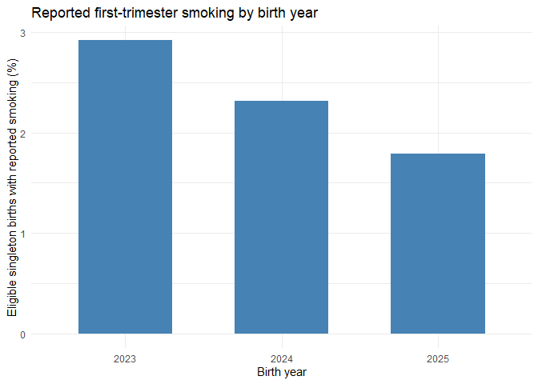

data analysis
================
Yikai Lu
2026-11-16

``` r
#Read the data we cleanded before
library(readr)
library(dplyr)
```

    ## 
    ## 载入程序包：'dplyr'

    ## The following objects are masked from 'package:stats':
    ## 
    ##     filter, lag

    ## The following objects are masked from 'package:base':
    ## 
    ##     intersect, setdiff, setequal, union

``` r
library(ggplot2)

# The path starts in your project folder.
clean_file <- "data/analysis_births_2023_2025.csv.gz"

# Stop here if R cannot find the file.
stopifnot(file.exists(clean_file))

# Read only the columns needed for the smoking and birth-weight analyses.
births <- read_csv(
  clean_file,
  col_select = c(year, smoked_trimester1, birth_weight_g, low_birth_weight),
  show_col_types = FALSE
)

# Display the first six records.
head(births)
```

    ## # A tibble: 6 × 4
    ##    year smoked_trimester1 birth_weight_g low_birth_weight
    ##   <dbl> <lgl>                      <dbl> <lgl>           
    ## 1  2023 FALSE                       3625 FALSE           
    ## 2  2023 FALSE                       3284 FALSE           
    ## 3  2023 FALSE                       3097 FALSE           
    ## 4  2023 FALSE                       3249 FALSE           
    ## 5  2023 FALSE                       3765 FALSE           
    ## 6  2023 FALSE                       3028 FALSE

``` r
#Verify the number of birth
year_counts <- births |>
  count(year, name = "eligible_births") |>
  arrange(year)

year_counts
```

    ## # A tibble: 3 × 2
    ##    year eligible_births
    ##   <dbl>           <int>
    ## 1  2023         3475888
    ## 2  2024         3506516
    ## 3  2025         3492221

\#Let’s start Q1 What percentage of eligible singleton births had
reported first-trimester smoking in 2023, 2024, and 2025?

``` r
# Every record in the cleaned dataset should have a known smoking status.
stopifnot(is.logical(births$smoked_trimester1), !anyNA(births$smoked_trimester1))

annual <- births |>
  group_by(year) |>
  summarise(
    eligible_births = n(),                      # All eligible births in this year
    reported_smoking = sum(smoked_trimester1),  # TRUE contributes 1, FALSE contributes 0
    smoking_pct = 100 * reported_smoking / eligible_births,
    .groups = "drop"
  ) |>
  arrange(year)

# Format the table for the report. Keep the year displayed as 2023.
annual |>
  mutate(year = as.character(year)) |>
  knitr::kable(
    digits = 2,
    format.args = list(big.mark = ","),
    col.names = c("Year", "Eligible births", "Reported smoking", "Smoking (%)")
  )
```

| Year | Eligible births | Reported smoking | Smoking (%) |
|:-----|----------------:|-----------------:|------------:|
| 2023 |       3,475,888 |          101,435 |        2.92 |
| 2024 |       3,506,516 |           81,231 |        2.32 |
| 2025 |       3,492,221 |           62,547 |        1.79 |

``` r
ggplot(annual, aes(x = factor(year), y = smoking_pct)) +
  geom_col(fill = "steelblue", width = 0.6) +
  labs(
    title = "Reported first-trimester smoking by birth year",
    x = "Birth year",
    y = "Eligible singleton births with reported smoking (%)"
  ) +
  theme_minimal()
```

<!-- -->

Among eligible U.S. singleton births, first-trimester smoking was
reported for 2.92% in 2023, 2.32% in 2024, and 1.79% in 2025.

\#How did average birth weight differ between births with and without
reported first-trimester smoking?

``` r
# Pool 2023–2025 and calculate the average birth weight within each group.
weight_summary <- births |>
  group_by(smoked_trimester1) |>
  summarise(
    n_births = n(),
    mean_weight_g = mean(birth_weight_g),
    .groups = "drop"
  )

# Display the two groups with readable labels.
weight_summary |>
  mutate(smoked_trimester1 = if_else(smoked_trimester1, "Yes", "No")) |>
  knitr::kable(
    col.names = c("Reported first-trimester smoking", "Births", "Mean birth weight (g)"),
    digits = 1,
    format.args = list(big.mark = ",")
  )
```

| Reported first-trimester smoking |     Births | Mean birth weight (g) |
|:---------------------------------|-----------:|----------------------:|
| No                               | 10,229,412 |               3,278.7 |
| Yes                              |    245,213 |               3,043.5 |

``` r
# Calculate the difference in grams using the unrounded group means.
difference_g <- with(
  weight_summary,
  mean_weight_g[smoked_trimester1] - mean_weight_g[!smoked_trimester1]
)
round(difference_g, 1)
```

    ## [1] -235.2

Among eligible U.S. singleton births in 2023–2025, mean birth weight was
3,043.5 g for births with reported first-trimester smoking and 3,278.7 g
for births with no reported first-trimester smoking. Across the three
years, reported first-trimester smoking was associated with a 235.2 g
lower mean birth weight in this unadjusted comparison.

So, we want to know how common was low birth weight in each group?

``` r
# Count low-birth-weight infants within each smoking group.
lbw_summary <- births |>
  group_by(smoked_trimester1) |>
  summarise(
    total_births = n(),
    low_weight_births = sum(low_birth_weight),  # Each TRUE counts as one birth
    low_weight_pct = 100 * low_weight_births / total_births,
    .groups = "drop"
  )

# Show the counts and percentages together.
lbw_summary |>
  mutate(smoked_trimester1 = if_else(smoked_trimester1, "Yes", "No")) |>
  knitr::kable(
    col.names = c("Reported smoking", "Total births",
                  "Low-birth-weight births", "Low birth weight (%)"),
    digits = 2,
    format.args = list(big.mark = ",")
  )
```

| Reported smoking | Total births | Low-birth-weight births | Low birth weight (%) |
|:-----------------|-------------:|------------------------:|---------------------:|
| No               |   10,229,412 |                 691,707 |                 6.76 |
| Yes              |      245,213 |                  36,727 |                14.98 |

Among eligible U.S. singleton births in 2023–2025, 14.98% of infants in
the reported first-trimester smoking group had low birth weight,
compared with 6.76% in the group with no reported smoking. That is an
absolute difference of 8.22 percentage points, or about 8 more
low-birth-weight infants per 100 births in the reported-smoking group.

so, next we will calculate the isk difference and risk ratio directly

``` r
# Select each group's percentage using its TRUE/FALSE smoking status.
pct_yes <- lbw_summary$low_weight_pct[lbw_summary$smoked_trimester1]
pct_no  <- lbw_summary$low_weight_pct[!lbw_summary$smoked_trimester1]

# Subtraction gives the absolute difference in percentage points.
risk_difference_pp <- pct_yes - pct_no

# Division gives the relative risk, using no reported smoking as the reference.
risk_ratio <- pct_yes / pct_no

risk_difference_pp
```

    ## [1] 8.215648

``` r
risk_ratio
```

    ## [1] 2.214983

Among eligible U.S. singleton births in 2023–2025, low birth weight
occurred in 14.98% of births with reported first-trimester smoking and
6.76% of births with no reported smoking. The unadjusted risk was 8.22
percentage points higher in the reported-smoking group, corresponding to
a risk ratio of 2.21.

``` r
clean_file <- "data/analysis_births_2023_2025.csv.gz"

births <- readr::read_csv(
  clean_file,
  col_select = c(year, maternal_age, smoked_trimester1,
                 birth_weight_g, low_birth_weight),
  show_col_types = FALSE
)

# Confirm that age is loaded and the row count matches your cleaning summary.
names(births)
```

    ## [1] "year"              "maternal_age"      "smoked_trimester1"
    ## [4] "birth_weight_g"    "low_birth_weight"

``` r
stopifnot("maternal_age" %in% names(births), nrow(births) == 10474625)

# Check how maternal age is recorded before using it in the model.
age_counts <- births |>
  count(maternal_age, name = "births") |>
  arrange(maternal_age)

print(age_counts, n = Inf)
```

    ## # A tibble: 39 × 2
    ##    maternal_age births
    ##           <dbl>  <int>
    ##  1           12    148
    ##  2           13    820
    ##  3           14   3790
    ##  4           15  12167
    ##  5           16  28943
    ##  6           17  57208
    ##  7           18 108259
    ##  8           19 189334
    ##  9           20 251339
    ## 10           21 300439
    ## 11           22 357286
    ## 12           23 405117
    ## 13           24 451775
    ## 14           25 498629
    ## 15           26 536619
    ## 16           27 575396
    ## 17           28 613961
    ## 18           29 646293
    ## 19           30 664071
    ## 20           31 673831
    ## 21           32 659533
    ## 22           33 626880
    ## 23           34 580545
    ## 24           35 516741
    ## 25           36 434292
    ## 26           37 351818
    ## 27           38 278609
    ## 28           39 214770
    ## 29           40 157783
    ## 30           41 108842
    ## 31           42  71333
    ## 32           43  43241
    ## 33           44  24385
    ## 34           45  13016
    ## 35           46   6706
    ## 36           47   3759
    ## 37           48   2201
    ## 38           49   1592
    ## 39           50   3154

``` r
# Confirm that adding the age column preserved the full analysis cohort.
stopifnot(sum(age_counts$births) == 10474625)
```

Fit the adjusted logistic regression

``` r
# Check the full age range and how many births have missing age.
births |>
  summarise(
    youngest_recorded = min(maternal_age, na.rm = TRUE),
    oldest_recorded = max(maternal_age, na.rm = TRUE),
    missing_age = sum(is.na(maternal_age))
  )
```

    ## # A tibble: 1 × 3
    ##   youngest_recorded oldest_recorded missing_age
    ##               <dbl>           <dbl>       <int>
    ## 1                12              50           0

``` r
# Within each group, count births below 2,500 g and births at or above 2,500 g.
model_counts <- births |>
  filter(!is.na(maternal_age)) |>
  group_by(smoked_trimester1, maternal_age, year) |>
  summarise(
    low_weight = sum(low_birth_weight),
    other_weight = sum(!low_birth_weight),
    .groups = "drop"
  )

# Confirm that every birth with a recorded age contributes to the model.
stopifnot(
  sum(model_counts$low_weight + model_counts$other_weight) ==
    sum(!is.na(births$maternal_age))
)
```

``` r
adjusted_model <- glm(
  cbind(low_weight, other_weight) ~
    smoked_trimester1 + factor(maternal_age) + factor(year),
  family = binomial(),
  data = model_counts
)

# Extract the coefficient comparing reported smoking with no reported smoking.
term <- "smoked_trimester1TRUE"
estimate <- coef(adjusted_model)[[term]]
se <- sqrt(vcov(adjusted_model)[term, term])

# Convert log odds to an adjusted odds ratio and a 95% Wald confidence interval.
adjusted_result <- tibble::tibble(
  adjusted_OR = exp(estimate),
  lower_95 = exp(estimate - 1.96 * se),
  upper_95 = exp(estimate + 1.96 * se)
)

knitr::kable(adjusted_result, digits = 3)
```

| adjusted_OR | lower_95 | upper_95 |
|------------:|---------:|---------:|
|       2.453 |    2.426 |    2.482 |

Among eligible U.S. singleton births in 2023–2025, low birth weight
occurred in 14.98% of births with reported first-trimester smoking and
6.76% of births with no reported smoking. After adjustment for maternal
age and birth year, the odds of low birth weight were 2.45 times as high
in the reported-smoking group (95% CI 2.43–2.48).

\###Here we finished Q1-3 but I find our project just focus on simple
one, to make a deeper research I am interested in , I will have Question
2. How does low-birth-weight risk vary with smoking intensity, and does
the pattern differ by maternal age? Question 3. Does knowing smoking
intensity improve prediction of low birth weight in a later year? And
then for previous three question, we combine them into one question: How
common was reported first-trimester smoking, and how did birth weight
differ between groups?
